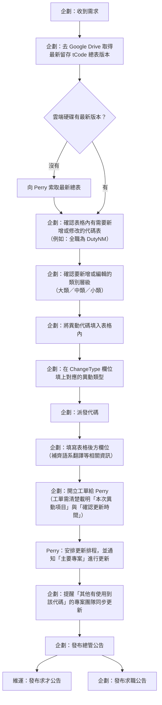

# 04 — tCode 異動 SOP 與協作 Handoff

> 本頁記錄「代碼表（tCode）新增與修改異動」的公司內部協作流程（企劃／Perry／維運三方），
> 以及本 KB 在這個流程裡扮演的角色、該讀哪些檔案、踩過的坑。接手這條工作線的人從這裡開始讀。

## 一、公司內部 SOP（企劃 → Perry → 各專案）

### 角色與職責

| 角色 | 負責什麼 |
|---|---|
| **企劃** | 全程主導：取得最新表、填異動內容、開工單、催各專案同步、發公告。是這個流程的驅動者。 |
| **Perry** | 持有/保管「最新留存總表」的人；收到工單後安排正式更新排程，通知主要專案套用。 |
| **主要專案** | 實際把異動寫進正式代碼表的工程單位（即本 KB 一路追蹤的「工程師」）。 |
| **其他使用該代碼的專案** | 不是主要擁有者，但有引用這張代碼表，異動後需要自行同步（企劃負責提醒，不負責幫他們改）。 |
| **維運** | 求才端公告發布窗口。 |
| **企劃（求職公告）** | 求職端公告另外由企劃自己發，跟維運的求才公告是平行的兩條，不是同一份。 |

### 關鍵檢查點（容易漏掉的地方）

1. **「最新留存總表」不等於這個 KB 分支現有的 `TCode_Export.xlsx`**——那是 Perry 保管的公司版本，流程一開始要先去 Drive 核對，而不是直接假設 KB 裡的版本是最新的。
2. **工單必須寫明「本次異動項目」＋「確認更新時間」**——這兩項缺一不可，是 Perry 排程的依據。
3. **公告分兩條線**：維運發求才公告、企劃發求職公告，不是同一人做。
4. **「其他有使用到該代碼的專案」同步是企劃的責任**，但同步動作本身由各專案自己做，企劃只負責提醒/追蹤。

## 二、本 KB 在這個流程裡的角色

本 KB（`job-classification-kb/`）是**企劃／審查側的工具**，不是 Perry 或主要專案那邊的正式系統。用途：

- **核對「企劃填好的異動表」是否正確、完整、沒有漏記**（例如：消失的代碼是否每一筆都有對應的 `Old_CodeNo`；新增項目欄位有沒有缺漏；ChangeType 是不是只是舊標記沒清掉）。
- **產出要開工單用的異動清單／公告文字**，給企劃直接拿去填工單或發公告，不用自己手動整理。
- **維護 KB 自己的資料層副本**（`TCode_Export.xlsx` 與 `data_*.md`），讓之後要查「現行代碼表長怎樣」不用每次重新下載官方匯出檔。**但這份副本的更新時機落後於官方流程**——要等 Perry 排程、主要專案實際套用之後，KB 才會拿「最新官方匯出」回來重建，不是異動一提出就同步。

### 技術側的鐵則（踩過的坑，全部記在這）

| 鐵則 | 為什麼 |
|---|---|
| **判斷真的改了什麼，要比對「修改前檔案」vs「修改後檔案」兩份獨立檔案的 CodeNameA/B/C，不要只信企劃填的 `ChangeType` 欄位** | ChangeType 常常掛著沒清（為了別的原因被標 edit，但內容其實沒變），也可能用錯 baseline 版本比對，生出假異動。完整方法論見 `.claude/skills/tcode-excel-ops/references/bulletinboard-rules.md`〈資料來源鐵則〉。 |
| **合併類異動（`move`/`move_edit`），被合併的每一個舊代碼都要各自一筆 `move` 列**，不是一個新代碼配一筆 | 一對多合併時容易漏記成只留最後一筆，要逐筆核對 `Old_CodeNo`，不能只看新代碼存不存在。 |
| **驗證「消失的代碼」是否正常**：只要能在某一列的 `Old_CodeNo` 查到，就算正常異動；查不到就是真的漏記 | 不要只看代碼還在不在，要看它有沒有被「designated」到新代碼。 |
| **xlsx 讀出來的 CodeNo 常是 float（如 `1006.0`）**，要先正規化成同一型別再比對 | 不然會全部對不上，誤判成「查無此代碼」。 |
| **大類/中類改名要 cascade 到底下所有子節點**，不是只改標題列 | 之前發生過中類改名了、底下葉節點卻還寫舊中類名稱，父子不一致。 |
| **新增代碼若决定「只新增、不跟既有項目合併」，要確認舊代碼真的被加回來、新代碼的 `ChangeType`／`Old_CodeNo` 也清掉**，不要留著合併痕跡 | 容易發生裁決改了但表格只改一半的情況。 |

## 三、相關文件地圖

| 要做什麼 | 看哪份 |
|---|---|
| 查某張表現況 | `tcode/data_*.md`（先讀 MD，不要直接開 Excel，見 `00-tcode-index.md`） |
| 產公告／異動清單 | `.claude/skills/tcode-excel-ops`（slash: `/tcode-bulletinboard`，規則在其 `references/bulletinboard-rules.md`） |
| 查某一輪異動的逐表明細、工程交辦紀錄 | `tcode/change_request_tCodeDuty_engineering.md`、`tcode/change_request_tCodeCertify_AI_certs.md` 這類逐批留存文件 |
| 全表欄位結構定義 | `01-schema.md` |
| 常用分析手法 | `02-analysis-recipes.md` |
| 本頁（SOP／協作流程） | `04-change-workflow-sop.md`（本檔） |
